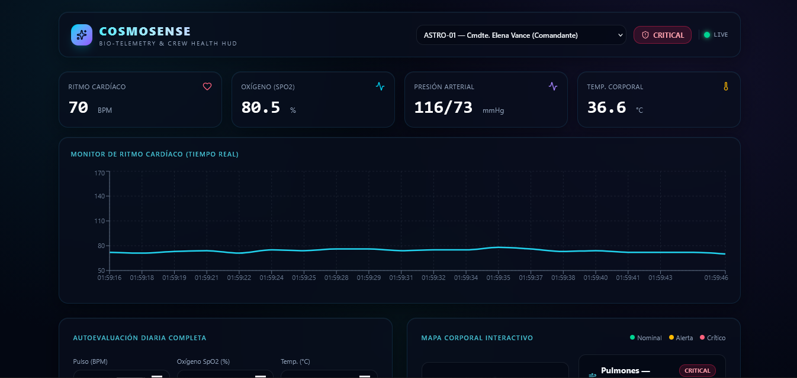
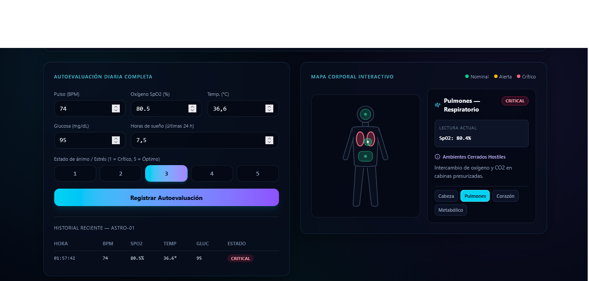
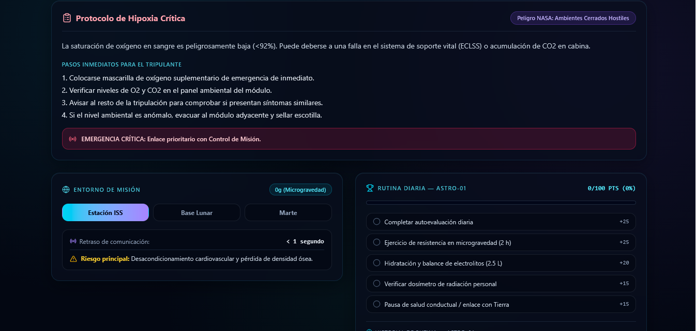

# cosmosense-nasa-spaceapps-2026
CosmoSense: plataforma orientada al monitoreo inteligente de la salud y telemetría de astronautas en misiones espaciales prolongadas.
# CosmoSense — Astronaut Health Telemetry & Diagnostics HUD

Aplicación full-stack de monitoreo biomédico, autoevaluación clínica y soporte a la toma de decisiones para tripulaciones espaciales, desarrollada en el marco del **NASA Space Apps Challenge 2026**.

## Funcionalidades Principales

* **Gestión Multi-Tripulante:** Selección independiente de astronautas (`ASTRO-01` a `ASTRO-04`) con telemetría, historial médico y rutina separados por persona.
* **Telemetría en Tiempo Real:** Visualización continua de ritmo cardíaco (BPM), saturación de oxígeno (SpO2), presión arterial y temperatura corporal, con gráfica en vivo.
* **Autoevaluación Diaria Completa:** Registro de signos vitales, glucosa en sangre, horas de sueño y estado de ánimo/estrés, con evaluación automática de estado (`NOMINAL`, `WARNING`, `CRITICAL`).
* **Protocolos de Acción NASA:** Activación automática de guías paso a paso asociadas a los riesgos del *Human Research Program* de la NASA (microgravedad, ambientes cerrados hostiles, radiación, aislamiento) e indicador de contacto con Cirujanos de Vuelo en Tierra.
* **Mapa Corporal Interactivo (SVG):** Silueta anatómica que actualiza el color de cada sistema (neuro-conductual, respiratorio, cardiovascular y metabólico) en tiempo real y despliega su ficha técnica al hacer clic.
* **Entorno y Rutina de Misión:** Selector de escenario (Estación ISS, Base Lunar Artemis, Tránsito a Marte) con datos de gravedad, retraso de señal y rutina diaria gamificada.
* **Persistencia en SQLite:** Almacenamiento local de historiales de autoevaluaciones y tareas de rutina con fecha y hora.

---

## Capturas de Pantalla

### Panel de Telemetría en Vivo


### Autoevaluación, Mapa Corporal y Protocolos


### Entorno de Misión y Rutina Diaria


---

## Stack Tecnológico

* **Backend:** Python, FastAPI, Pydantic, Uvicorn, SQLite3.
* **Frontend:** React, Vite, Tailwind CSS, Recharts, Lucide React.

---

## Estructura del Proyecto

```text
cosmosense-nasa-spaceapps-2026/
├── assets/          # Capturas de pantalla para documentación
├── client/          # Frontend en React + Vite + Tailwind CSS
│   └── src/
│       ├── App.jsx
│       ├── BodyMap.jsx
│       ├── MissionRoutine.jsx
│       └── index.css
├── server/          # Backend en FastAPI + SQLite
│   ├── main.py
│   └── requirements.txt
└── README.md

## Instalación y Ejecución Local

### 1. Clonar el repositorio
```bash
git clone [https://github.com/candeorellano/cosmosense-nasa-spaceapps-2026.git](https://github.com/candeorellano/cosmosense-nasa-spaceapps-2026.git)
cd cosmosense-nasa-spaceapps-2026

### 2. Levantar el backend (/server)
```bash
cd server
python -m venv venv
source venv/Scripts/activate   # En Windows PowerShell: .\venv\Scripts\Activate.ps1
pip install -r requirements.txt
python -m uvicorn main:app --reload --port 8000

La base de datos cosmosense.sqlite3 se genera automáticamente al iniciar el servidor.

### 3. Levantar el frontend (/client)
```bash
cd client
npm install
npm run dev

Abre http://localhost:5173 en tu navegador.

Autora: Desarrollado por Candela Orellano